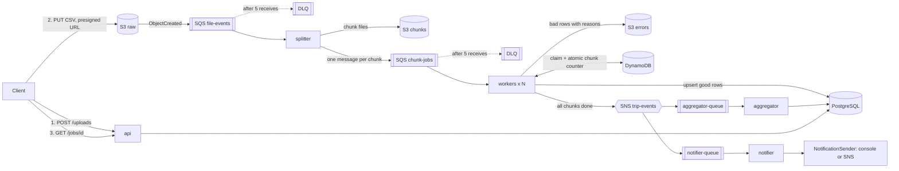
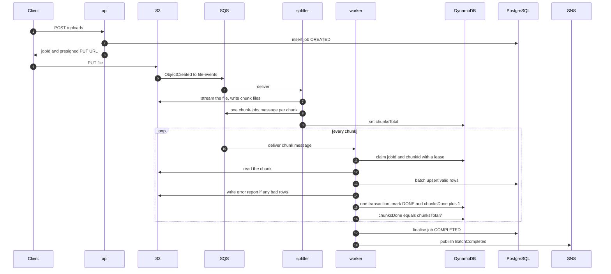
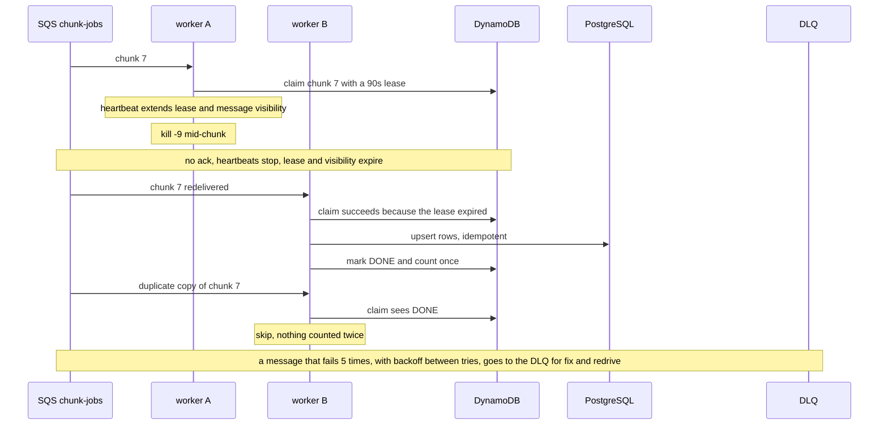

# TripStream

An event-driven pipeline that ingests large CSV files of trips on AWS (S3, SQS, SNS, DynamoDB) with Spring Boot 3 /
Java 21 and PostgreSQL. A client uploads a file; the system validates it, processes it in parallel chunks, stores clean
rows, reports bad rows, and fans out events to an aggregator and a notifier. It survives worker crashes, duplicate
delivery and poison messages **without losing or double-counting data**, and that claim is tested, not asserted.

All data is synthetic (`scripts/generate_trips.py`). Runs locally with `docker compose` and LocalStack (no AWS account);
the Terraform in `infra/terraform` provisions the AWS side.

**Status:** pipeline, reliability work, fan-out, benchmarks and chaos tests done and tested. Terraform for storage,
messaging, IAM and alarms is validated against LocalStack but **not applied to real AWS**; ECS/RDS deployment was
intentionally skipped. Benchmarks are local (emulated AWS services): see the caveats in [docs/benchmarks.md](docs/benchmarks.md).

## Architecture



One Spring Boot codebase, five roles selected by profile (`api`, `splitter`, `worker`, `aggregator`, `notifier`), each
independently runnable and scalable.

### Happy path



### Failure path: worker killed mid-chunk, then a duplicate



## What happens when...

Full detail and the test that proves each row: [docs/failure-modes.md](docs/failure-modes.md).

| Failure | Result |
|---|---|
| Worker `kill -9` mid-chunk | lease and visibility expire, another worker redoes the chunk; counted once |
| Message delivered twice (before or during processing) | second copy sees DONE or a live claim and does nothing |
| Chunk takes longer than the visibility timeout | heartbeat extends both; nothing is reprocessed (control test shows what happens without it) |
| Poison message | exponential backoff, then DLQ after 5 receives; other work flows past it |
| S3 object missing | same path to the DLQ; restore the object and redrive, the job completes |
| Database down for a while | chunks fail fast, back off, retry; nothing lost |
| Bad rows in a file | never fail the file: they go to a per-chunk error report and the job's `badRows` |
| Garbage file / wrong header | job `FAILED` cleanly, nothing enqueued |
| `BatchCompleted` delivered twice | stats recomputed idempotently, one notification per job |

**How "exactly once" is built on at-least-once queues:** idempotent handlers, not magic. Claim `jobId#chunkId` in
DynamoDB (conditional put with a lease); mark DONE and increment the job's counter in a single DynamoDB transaction;
upsert trips on the natural key `trip_id` (no-op updates skipped); finalise the job idempotently from whoever sees
`chunksDone == chunksTotal`; recompute (not increment) aggregates.

## Run it locally

Prerequisites: Java 21, Maven 3.9+, Docker, Python 3.

```bash
docker compose up -d --wait        # Postgres 16 + LocalStack with buckets, queues, DLQs, topics, tables, subscriptions
mvn -DskipTests -DskipITs package

# start the api first on a fresh database (it runs the Liquibase migrations, ADR-005), then the other roles
java -jar target/tripstream-0.1.0-SNAPSHOT.jar --spring.profiles.active=api
java -jar target/tripstream-0.1.0-SNAPSHOT.jar --spring.profiles.active=splitter
java -jar target/tripstream-0.1.0-SNAPSHOT.jar --spring.profiles.active=worker       # run several to scale out
java -jar target/tripstream-0.1.0-SNAPSHOT.jar --spring.profiles.active=aggregator
java -jar target/tripstream-0.1.0-SNAPSHOT.jar --spring.profiles.active=notifier

python3 scripts/generate_trips.py --rows 100000 --bad-pct 5 --dup-pct 2 --out data/generated/trips.csv
scripts/upload.sh data/generated/trips.csv http://localhost:8080
```

Default ports are api 8080, splitter 8081, worker 8082, aggregator 8083, notifier 8084. If a host port is taken, override
it: `POSTGRES_PORT=5445 LOCALSTACK_PORT=4577 docker compose up -d` (and `DB_URL` / `AWS_ENDPOINT`), and
`--server.port=...` per role.

### Two-minute demo

`scripts/demo.sh` starts the whole stack and shows (1) a 100k-row upload completing with exact counts, an error report,
aggregated stats and a notification, then (2) a 1M-row upload during which it `kill -9`s a worker and still ends on exact
counts. Run it while screen-recording (`asciinema rec`, QuickTime, ...); a recording is not checked into the repo yet.

### API

| Endpoint | Purpose |
|---|---|
| `POST /uploads` | create a job, returns `{jobId, key, uploadUrl, expiresAt}`; `PUT` the CSV to `uploadUrl` |
| `GET /jobs/{id}` | status (`CREATED`, `RECEIVED`, `PROCESSING`, `COMPLETED`, `FAILED`) and `totalRows` / `goodRows` / `badRows` |
| `GET /jobs/{id}/errors` | presigned links to the error reports (`row_number,reason,raw_line`) |
| `POST /admin/redrive/{queue}` | move a DLQ's messages back to its source queue (no auth: keep private); `scripts/redrive.sh` wraps it |

## Tests

`mvn verify` (about 7 minutes, Docker required) runs 8 unit and 20 integration tests against real Postgres and
LocalStack containers; there are no mocks of the infrastructure, and synchronisation uses Awaitility (the one fixed wait is
the deliberate 9 s database-outage window).

| Test | Proves |
|---|---|
| `PipelineIT` | 100k rows, 5% bad, 2% duplicates give exactly 93,000 good / 5,000 bad; redelivering every message changes nothing |
| `FailureModesIT` | `kill -9` of a real worker process, in-flight duplicates, heartbeat vs no heartbeat, poison message to DLQ, missing S3 object then redrive, database outage |
| `FanOutIT` | stats and notifications exactly once despite redelivered events and an overlapping re-upload |
| `IngestionIT`, `RoleProfilesIT`, `LocalStackInitScriptIT`, `RowValidatorTest` | upload and event wiring, each role starts alone, infra script, validation rules |

## Benchmarks

Local, LocalStack, one laptop (not AWS numbers); details, method and caveats in [docs/benchmarks.md](docs/benchmarks.md).

| | |
|---|---|
| 5M-row file, 4 workers | 75 s, **66,692 rows/s**, exact counts |
| 1 -> 4 workers (1M rows) | 33,205 -> 67,901 rows/s (2.05x); no gain beyond about 4 |
| Why it stopped scaling | row-lock contention between chunk transactions (74% of active DB sessions waiting on `Lock:transactionid` at 8 workers), found with `pg_stat_activity` and confirmed with a no-duplicates control |
| After shortening transactions (`commit-per-batch`) | **103,663 rows/s** at 4 workers (+53%); 115,216 at 8 workers with batched-insert rewrite |
| 4x `kill -9` of workers + 35% of chunk messages duplicated (1M rows) | zero loss, zero double counting |
| Poison flood (300k all-bad rows, garbage files) next to a legit job | contained; legit job exact |

## Design trade-offs

**SQS (+SNS) rather than Kinesis or Kafka.** The unit of work is an independent chunk: no ordering requirement, a
per-message ack, independent retries, a DLQ and consumers that scale freely are exactly SQS's model. On a log (Kinesis,
Kafka) parallelism is capped by partitions, a failing record blocks its partition unless you build retry topics and
DLQs by hand, and offset-based acking does not map to "this one chunk failed, retry just it". A log would win if
consumers needed replay, strict ordering or very high event rates; SNS fan-out covers the multi-consumer need here.
Standard (not FIFO) queues give the throughput and scaling; FIFO's dedupe window is only 5 minutes, so durable dedupe is
built into the handlers instead.

**Chunk size (5,000 rows).** Measured on 1M rows with 4 workers:

| Chunk rows | Chunks | Rows/s | Chunk p50 / p95 / p99 |
|---|---|---|---|
| 1,000 | 1,000 | 54,734 | 0.03 / 0.05 / 0.07 s |
| **5,000** | 200 | 57,841 | 0.22 / 0.64 / 0.93 s |
| 20,000 | 50 | 46,789 | 1.57 / 2.97 / 3.25 s |

Single runs: the same 5,000-row configuration measured 67,901 rows/s earlier, so differences under about 15% are noise.
The clear signals are that 20,000-row chunks are slower (about 19% here) and take about 7x longer each, and that
1,000-row chunks buy no throughput while multiplying messages and DynamoDB operations by 5.

Small chunks multiply messages, DynamoDB operations and per-chunk overhead; large chunks hold database locks longer,
take longer to retry after a worker dies and use more memory per message. A chunk that takes a fraction of a second
keeps recovery after a crash to one short chunk plus the lease, and keeps heartbeats rarely needed.

**Postgres for results, DynamoDB for coordination.** Trips are queried and aggregated (daily per-vehicle stats, joins,
`ON CONFLICT` upserts on the natural key), which is relational work; at DynamoDB on-demand pricing, writing 5M rows would
also cost about $6 per file in write units alone versus compute time on a database you already run. DynamoDB holds what
it is good at: tiny hot items needing conditional writes, atomic counters and TTL (idempotency claims, chunk counters).
The honest cost of that split: marking a chunk done spans two stores, so correctness rests on the claim, the
idempotent upsert and the final DynamoDB transaction rather than one database transaction. Keeping the counter in
Postgres, in the same transaction as the upserts, would be simpler; DynamoDB was a requirement of the project brief,
and it keeps coordination traffic off the database that takes the bulk writes.

**Recompute, don't increment, aggregates.** The aggregator recomputes the vehicle-days a job touched from `trips`, which
makes duplicates, reordering and overlapping uploads harmless (ADR-007).

**What I would do next:** apply and tear down the Terraform on a real account; add ECS Fargate + RDS; make
`commit-per-batch` and batched-insert rewrite the defaults after extending the failure suite to cover them; add
authentication to the admin endpoint; add a job timeout so a job with a parked chunk does not sit in `PROCESSING` forever.

## Infrastructure as code

`infra/terraform`: buckets, queues with DLQs, SNS fan-out, DynamoDB tables, one least-privilege IAM role per application
role and CloudWatch alarms (DLQ not empty, oldest message age). Validated and applied/destroyed against LocalStack, with
the pipeline run against it; see [infra/terraform/README.md](infra/terraform/README.md).

## Layout and docs

- `src/main/java/com/tripstream/` : `roles`, `jobs` (API, completion), `ingest` (splitter), `chunk` (worker), `state` (DynamoDB ledger), `events`, `aggregator`, `notifier`, `reliability` (backoff, heartbeat, redrive)
- `src/main/resources/db/changelog` : Liquibase schema
- `infra/localstack/init-aws.sh` : local AWS resources; `infra/terraform` : AWS resources
- `scripts/` : data generator, upload, redrive, demo, `bench/bench.py` (load and chaos harness)
- [docs/decisions.md](docs/decisions.md) : ADRs, [docs/failure-modes.md](docs/failure-modes.md), [docs/benchmarks.md](docs/benchmarks.md)
